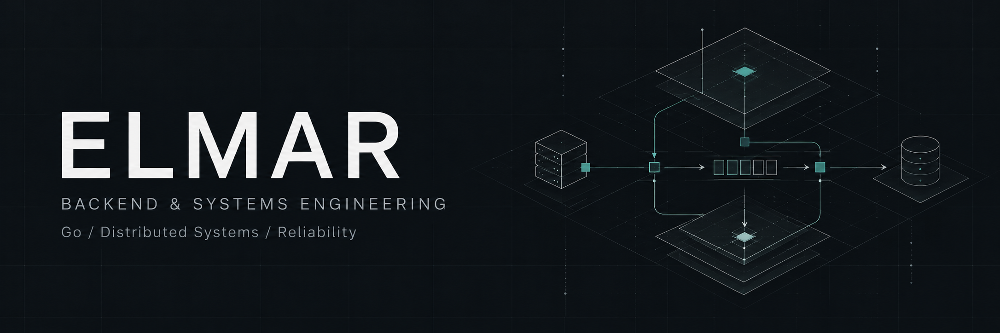

  

# Hi, I'm Elmar

**Backend engineer · Go / Erlang / Elixir / C**

I build backend systems with particular attention to **concurrency, data integrity, and recovery from failure**. My work spans service architecture, asynchronous processing, database design, and the infrastructure that keeps applications running.

Commercial backend development is my main work. Outside it, I build my own products and self-hosted infrastructure, taking an idea through APIs, storage, workers, interfaces, and operational tooling.

  
  
  
  
  
  
  
  

  <a href="#engineering-focus">Engineering focus</a> &nbsp;·&nbsp;
  <a href="#selected-public-work">Public work</a> &nbsp;·&nbsp;
  <a href="#products-im-building">Products</a> &nbsp;·&nbsp;
  <a href="#contact">Contact</a>

## Engineering focus

- **Concurrency & performance:** goroutine lifecycles, cancellation, bounded worker pools, backpressure, lock contention, allocations, and latency. I approach optimization through profiling and measurement.

- **Durable asynchronous work:** transactional outbox, idempotency keys, delivery acknowledgements, retry budgets, worker leases, and fencing. Ambiguous outcomes need reconciliation before another side effect.

- **Data integrity & isolation:** PostgreSQL transactions, locking, indexes, query plans, migrations, and row-level security. Tenant identity and authorization must remain explicit across APIs, jobs, and storage.

- **Service boundaries & contracts:** REST, gRPC, Protobuf, authentication, and separation of public traffic from administrative control. Clear ownership of state matters as much as the transport.

- **Security & operations:** scoped credentials, mTLS, encrypted payloads, readiness, graceful shutdown, metrics, and recovery procedures. Verification includes failure paths and tests against real dependencies.

- **AI workflow infrastructure:** durable execution, provider budgets, artifact identity, permission boundaries, and checks before publication. I am interested in making generation workflows traceable and recoverable.

## Selected public work

### 01 / [selfmail](https://github.com/Elmar006/selfmail)

**Self-hosted transactional email infrastructure.** A Go service with REST, SMTP submission, and a Go SDK, backed by PostgreSQL, RabbitMQ, Redis, and Postfix.

The engineering core: tenant RLS, transactional outbox, bounded delivery workers, idempotent acceptance, encrypted content, and explicit delivery states. API acceptance, MTA submission, and remote delivery are tracked separately; an unknown handoff is reconciled.

[Architecture](https://github.com/Elmar006/selfmail/blob/main/docs/architecture.md) · [Integration](https://github.com/Elmar006/selfmail/blob/main/docs/integration.md) · [Recovery](https://github.com/Elmar006/selfmail/blob/main/docs/recovery.md)

### 02 / [API Gateway / RouteFlow](https://github.com/Elmar006/API-Gateway)

**A Go reverse proxy with a desktop control plane.** PostgreSQL-backed dynamic routes, a method/path trie, a sharded token-bucket limiter, asynchronous batch logging, and separate public and administrative HTTP servers.

RouteFlow adds a Tauri + React interface for inspecting topology and configuring routes. The project connects backend traffic handling with a usable operational interface.

[Backend](https://github.com/Elmar006/API-Gateway/tree/master/backend) · [Routing implementation](https://github.com/Elmar006/API-Gateway/blob/master/backend/internal/infrastructure/router/trie.go) · [Control plane](https://github.com/Elmar006/API-Gateway/tree/master/client)

### 03 / [Энергоконтур / Energokontur](https://github.com/Elmar006/energy_web)

**Planning and simulation for EV charging infrastructure.** A project connecting site selection, grid capacity, charging demand, equipment, and phased investment.

An independent operational simulation examines queues, power sharing, demand changes, and equipment failures. This is where my interest in backend engineering meets optimization and modelling real operating constraints.

## Products I'm building

Alongside my main work, I develop product systems where backend correctness has a direct effect on everyday operations.

| Product | Domain & engineering work |
| :--- | :--- |
| **Devora** | An AI-assisted website and business platform. My focus includes generation workflows, artifact lifecycle, publication boundaries, and CRM context. |
| **Korger** | An automotive-service platform spanning a public site and staff CRM. Work includes scheduling, repair workflows, permissions, inventory, finance, media processing, and live updates. |
| **NRAV** | A coffee-shop platform connecting a website, Telegram Mini App, and staff tools. Work includes pickup scheduling, order state, reservations, payments, and notification workflows. |

These product repositories are private. Public implementation examples are linked above.

## Tools & deeper interests

**Core:** Go · Erlang/OTP · Elixir/BEAM · C · SQL 
**Data & messaging:** PostgreSQL · Redis · RabbitMQ · MySQL · Kafka fundamentals 
**Interfaces:** REST · gRPC · Protobuf · WebSocket · SSE 
**Infrastructure:** Linux · Docker / Compose · GitHub Actions · Prometheus 
**Product interfaces:** TypeScript · React · Next.js · Tauri

I spend time on **OTP supervision, process isolation, memory behaviour, and failure semantics**: how to contain a fault, bound resource use, preserve ownership of state, and recover predictably. I also care about readable code, explicit dependencies, and improving legacy systems in manageable steps.

## Contact

[Telegram ↗](https://t.me/viy1ix) &nbsp;·&nbsp; [Email ↗](mailto:birembekove@gmail.com)
